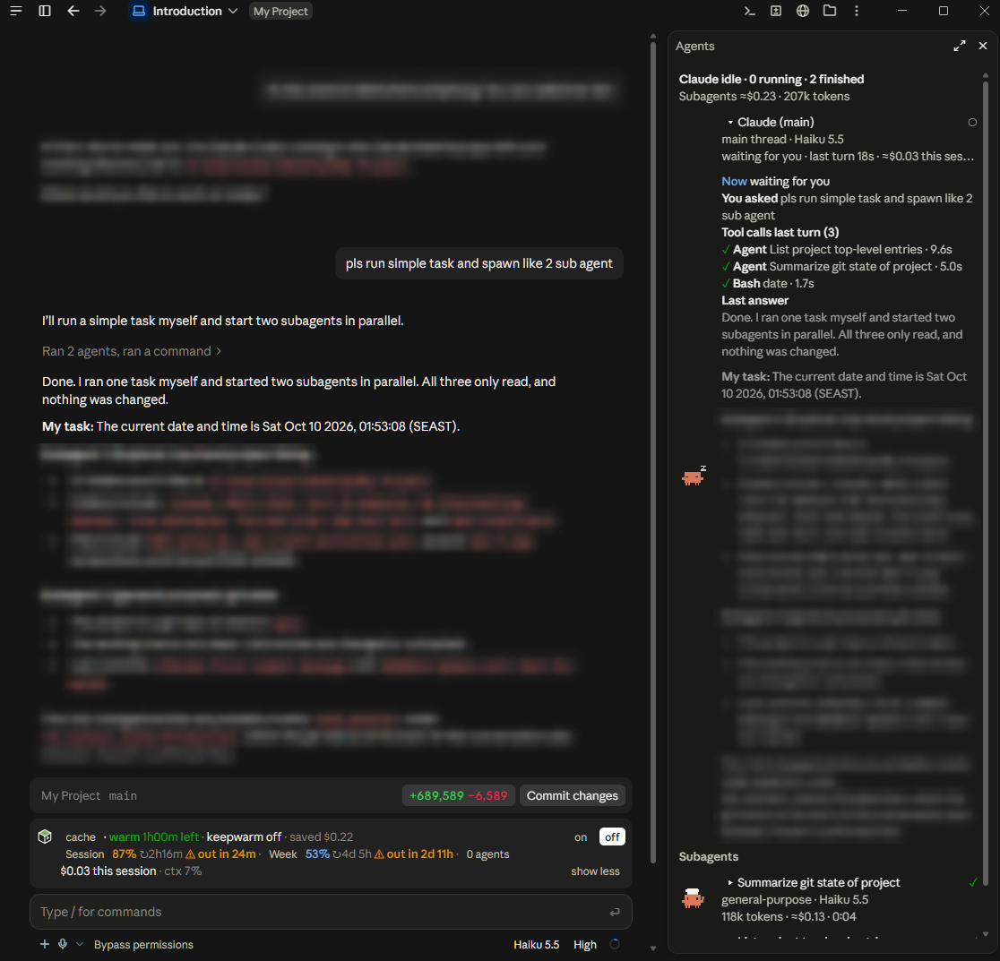
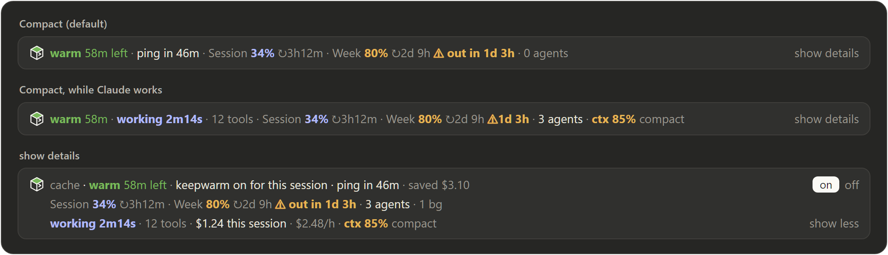
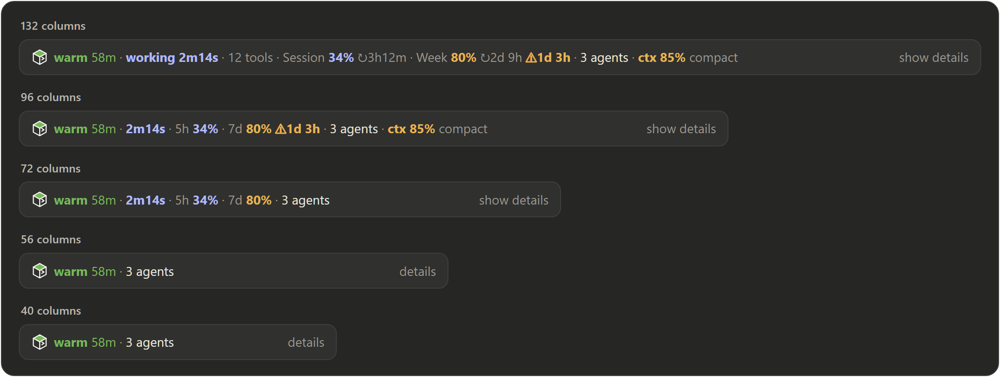
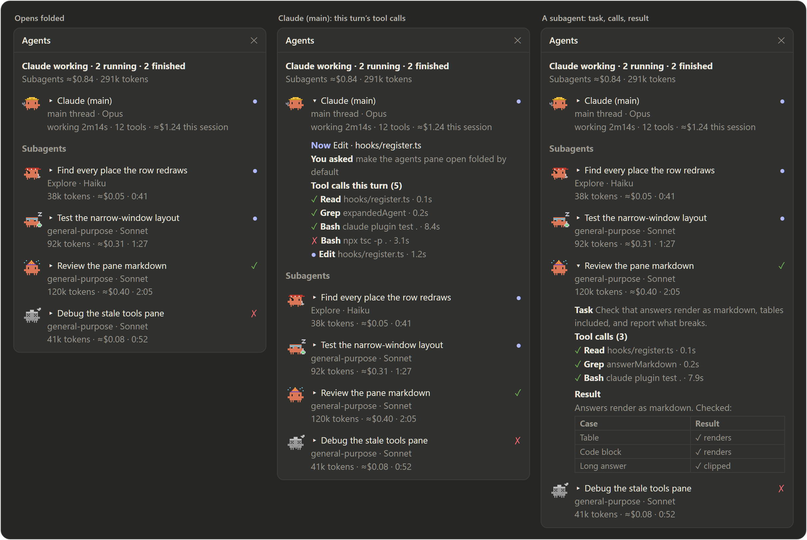
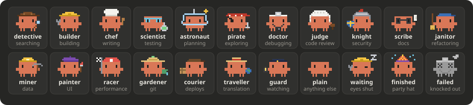
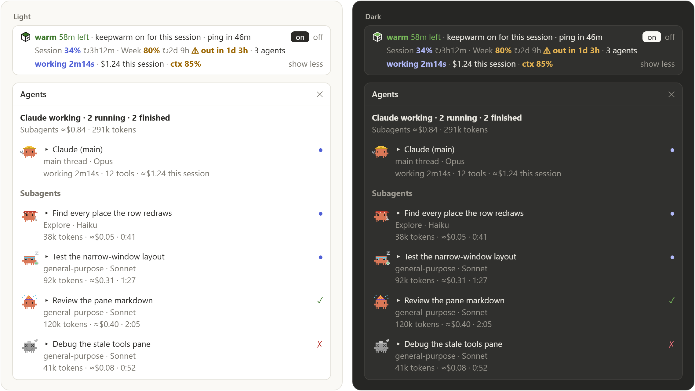

# Claude Code Mods

**cc-hud** is a Claude Code mod: it customizes the interface with a heads-up row and a live Agents pane. It is distributed as a plugin; the repository and install name remain `cc-hud`.

Terminology reference: [Claude Code Mods are game changers](https://uxplanet.org/claude-code-mods-are-game-changers-39a566cddca5).

**One row above the Claude Code prompt that shows your prompt cache, plan usage, the turn in progress, and running agents.** Click it for details, or open the Agents pane to see what every agent is doing.



<sub>In the desktop app's Code tab: the cc-hud row sits above the prompt, and the **Agents** pane opens on the right. Chat text is blurred for privacy.</sub>

<picture>
  <source media="(prefers-color-scheme: light)" srcset="assets/row-light.png">
  
</picture>

Requires Claude Code **2.1.287+**. Works in the terminal and the desktop app's Code tab.

## Install

```bash
claude plugin marketplace add https://github.com/RathaTart/cc-hud.git
```

```bash
claude plugin install cc-hud@cc-hud
```

Start a session and the row appears after your first message. If you have cache-tax installed, disable it first: both plugins register `/keepwarm` and `/cache-tax`.

## The row

- **Compact** by default. **show details** splits it into three lines and adds the keepwarm **on / off** switch. **show less** folds it back, and your choice is remembered.
- **Everything is clickable.** Click `N agents` or `N tools` for the Agents pane, `Session` or `Week` for the `/hud` breakdown, and `compact` to run `/compact`. A click made mid-turn runs once the turn ends.

| You see | It means |
|---|---|
| `warm 58m left` | Time left on the one-hour prompt cache. When it says `cold`, your next message pays full price. |
| `ping in 46m` | When the next keepwarm ping goes out. Keepwarm is off in every new session until you turn it on. |
| `working 2m14s · 12 tools` | Claude is mid-turn. A turn of a minute or more ends with a toast and a chime. |
| `Session 34% ↻3h12m` · `Week 80% ↻2d 9h` | How much of your plan's 5-hour and 7-day limits you've used, and when each resets. Amber from 75%, red from 90%. |
| `⚠ out in 1d 3h` | At this pace, the limit runs out before it resets. You also get a toast at 80% and 95%. |
| `3 agents` | Agents at work, counting the main Claude while it runs. |
| `ctx 85% compact` | The context window is over 80% full. |
| `saved $3.10` · `$1.24 this session · $2.48/h` | In the details: what cache reads saved, and the session's cost so far. Both are estimates at API prices. |

**It fits any width.** As the window narrows, the row gives up detail rather than wrapping. The cache and the agent count go last.

<picture>
  <source media="(prefers-color-scheme: light)" srcset="assets/responsive-light.png">
  
</picture>

## The Agents pane

To open it, click the agent count, click `N tools`, or run `/hud agents`. It opens at once, even while Claude is working, and updates live.

<picture>
  <source media="(prefers-color-scheme: light)" srcset="assets/pane-light.png">
  
</picture>

- **Claude (main)** is pinned first, with each **subagent** below it, newest first. Each row shows its model, tokens, cost, time, and status (● running, ✓ done, ✗ failed). The pane keeps the newest 100 subagents.
- **Every row starts folded.** Click a name to open it and see:
  - what the agent is doing now
  - its task, or what you asked
  - each tool call with its result and time
  - its answer, rendered as markdown with tables
- **Secrets are masked** as `•••` before anything is shown: tokens, keys, passwords, and auth headers. This is best effort, so keep secrets out of commands where you can.

### Costumes

Each agent dresses for its task. The main Claude dresses for the tool it's using: the detective while it reads, the builder while it edits.



- **Running** agents bob, walk, and work their prop.
- **Waiting** agents shut their eyes and show a floating z.
- **Finished** agents wear a party hat for six seconds.
- **Failed** agents turn gray and are knocked out.

Nothing moves if your system asks for reduced motion. The terminal shows each costume as an emoji (🔍 🔧 🧪 …) instead.

The desktop app draws up to 12 costumes: Claude (main) first, then running agents, then the newest. Other rows show the emoji, so a workflow with dozens of agents still draws quickly.

## Light and dark

The row and pane follow Claude Code's theme.



## Commands

| Command | What it does |
|---|---|
| `/hud` | Full breakdown: each limit with pace and forecast, a week of daily peaks, cost, savings, context, agents, background work. |
| `/hud agents` | Opens or closes the Agents pane. `/hud tools` does the same. |
| `/hud chime on` · `off` | Turns the end-of-turn chime on or off. |
| `/keepwarm on` · `off` · `90m` · `always` | Keeps the cache warm: for this session, never, for a set time, or in every session. |
| `/cache-clock on` · `off` | Replaces the row with a cache clock that ticks every second. |
| `/cache-tax` | The cache card and the cold-send guard, as in cache-tax. |

## Cost

The row and pane cost **no tokens**: they read figures Claude Code already has. **Keepwarm pings are model requests and do cost tokens.** They only run when you turn keepwarm on.

## Develop

```bash
claude plugin validate .claude-plugin/plugin.json
```

```bash
claude plugin test .
```

To work from a local checkout, run `claude plugin marketplace add path/to/cc-hud`, then `/reload-plugins` after each edit.

## Credits

cc-hud is inspired by these two projects and builds on them:

- **[cache-tax](https://github.com/karanb192/cache-tax)** by Karan Bansal (MIT): the cache clock, keepwarm, the cold-send guard, and the cache icons.
- **[savvy-progress](https://github.com/JohnnyVizz/claude-kit/tree/main/plugins/savvy-progress)** by JohnnyVizz: the idea of a pane with costumed agents.

The top screenshot is a real capture from the desktop app. The other previews are rendered from cc-hud's own layout code, icons, and sprites with sample data. Fonts and spacing in your client may differ slightly.

MIT License. See [`LICENSE`](LICENSE).
